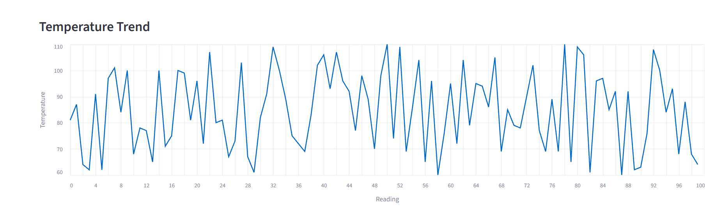
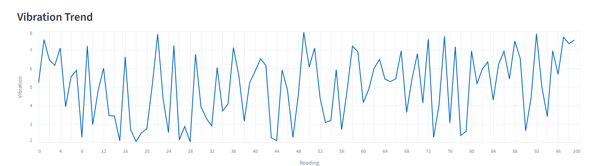
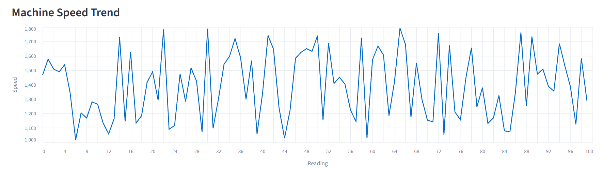

# Machine Digital Twin Dashboard

A learning project that builds a **digital twin** of an industrial machine (ID: `M001`). It simulates sensor data, stores it in CSV files, analyses it, and shows the machine's live condition on a Streamlit dashboard.

> **Note:** All sensor data is **simulated**. No real machine is connected.

## What is a digital twin?

A digital twin is a virtual copy of a physical asset that is kept in sync with sensor data. It lets you monitor the asset's condition, spot problems early and test what-if scenarios without touching the real machine.

## Features

- Simulated sensor readings: temperature (°C), vibration (mm/s) and machine speed (RPM)
- Rule-based status classification: `NORMAL` / `WARNING`
- Live Streamlit dashboard with:
  - Current machine status banner
  - Latest sensor readings
  - Trend charts for temperature, vibration and machine speed (last 100 readings)
  - Table of recent readings
  - Normal vs warning reading summary
- Offline analysis and visualization scripts

## Architecture

```
sensor_simulation.py  ->  CSV data  ->  digital_twin.py (status logic)  ->  app.py (Streamlit dashboard)
                                    ->  analyze_machine.py / visualize_machine.py (offline analysis)
```

## Project structure

| File / Folder | Purpose |
|---------------|---------|
| `sensor_simulation.py` | Generates simulated sensor readings |
| `digital_twin.py` | Core twin logic: reads data and decides machine status |
| `live_digital_twin.py` | Continuously updating twin |
| `live_digital_twin_csv.py` | Live twin that writes readings to `live_machine_data.csv` |
| `analyze_machine.py` | Summary statistics of the machine data |
| `visualize_machine.py` | Generates charts into the `visualizations/` folder |
| `app.py` | Streamlit dashboard |
| `machine_data.csv` | Sample dataset |
| `screenshots/` | Dashboard screenshots used in this README |
| `requirements.txt` | Python dependencies |

## Getting started

```bash
# 1. Clone the repository
git clone https://github.com/Shamini-tech/Digital-Twin.git
cd Digital-Twin

# 2. (Optional) create a virtual environment
python -m venv venv
venv\Scripts\activate        # Windows
# source venv/bin/activate   # macOS / Linux

# 3. Install dependencies
python -m pip install -r requirements.txt

# 4. Run the dashboard
python -m streamlit run app.py
```

Then open http://localhost:8501 in your browser.

## Status rules

A reading is flagged `WARNING` when a sensor value crosses its threshold, otherwise it is `NORMAL`. The thresholds are defined at the top of `app.py` (`TEMP_LIMIT`, `VIBRATION_LIMIT`) and can be changed in one place.

## Screenshots

### Dashboard overview


### Temperature trend


### Vibration trend


### Machine speed trend


## Tech stack

Python, Pandas, NumPy, Matplotlib, Streamlit, Altair

## Future improvements

- Anomaly detection (rolling z-score or Isolation Forest)
- Predictive-maintenance risk score
- Support for multiple machines
- Real sensor input via MQTT

## Author

**Shamini S** — [GitHub](https://github.com/Shamini-tech)